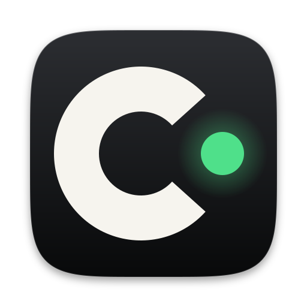

<p align="center"></p>

# Caprock — Claude Code plugin

**Give Claude Code a memory of your own work.** This plugin lets Claude Code
ask [Caprock](https://caprock.dev), the free desktop app that records every
coding-agent session on your computer, instead of you pasting things in:

- *"What did we decide about the auth flow last week?"* — Second Brain
  memories and the decisions in force for this repository.
- *"Which session touched the billing code, and what did it say?"* — what
  past sessions did and wrote, searchable across all of them.
- *"How much has this repo cost this month, and on which model?"* — spend
  and tokens per repository, day and model.
- *"Is CI green on my PR?"* — GitHub Actions on the default branch and the
  open pull request.
- *"Is any agent stuck?"* — running sessions repeating the same tool call.

## Install

You need the Caprock app running: get it free at
**https://caprock.dev/install** (macOS, Windows, Linux).

Then, in a terminal:

```bash
claude plugin marketplace add dspv/caprock-plugin
claude plugin install caprock@caprock
```

or inside a Claude Code session: `/plugin marketplace add dspv/caprock-plugin`,
then `/plugin install caprock@caprock`.

The same plugin is also published from the main repository
(`claude plugin marketplace add dspv/caprock`); use one, not both.

## Tools

| Tool                   | What it answers                                                           |
| ---------------------- | ------------------------------------------------------------------------- |
| `search_memories`      | Up to 30 ranked Second Brain memories for some words, to judge by meaning |
| `current_decisions`    | The decisions in force for this repository, newest first                  |
| `get_memory`           | One memory in full, with what it links to                                 |
| `memory_topics`        | The topics Second Brain knows, and the memories per project               |
| `next_session_handoff` | What a new session here is handed: current decisions, then memories       |
| `recent_sessions`      | Recent sessions here (or everywhere): status, branch, cost, loop alert    |
| `session_summary`      | One session: description, files touched, pull requests, cost              |
| `session_prose`        | What one session's agent wrote, newest first                              |
| `search_prose`         | What agents wrote, searched across every session                          |
| `cost`                 | Spend and tokens per day and model, for this repository or all            |
| `ci_status`            | GitHub Actions on the default branch and the open pull request            |
| `loop_alerts`          | Running sessions repeating the same tool call                             |

Costs are Caprock's own figures at API list prices; on a Pro or Max plan they
are what the same usage would cost on the API, not what you were billed.

## Your data

- **Read-only.** One MCP server, `caprock mcp`. No tool can type into a
  session, start or stop one, write a memory or change a setting.
- **Local.** The server is a child process of Claude Code on stdin and
  stdout, opens no port, and reads the Caprock app on this computer over
  `127.0.0.1`.
- **Sends nothing anywhere.** No telemetry; nothing goes to Caprock or anyone
  else. What a tool returns goes into your Claude Code conversation, like your
  prompts and code. Credentials and payment details are redacted first. The CI
  tool reads GitHub only through the connection you set up in Caprock.

## When Caprock isn't found

`scripts/caprock-mcp` (and `caprock-mcp.cmd` on Windows) looks for `caprock`
on your `PATH`, then where the app and the package managers install it. If
there is none, it prints where to get it on stderr and starts nothing. It
downloads nothing.

## More

- Full tool reference: https://github.com/dspv/caprock/blob/master/docs/mcp.md
- The app and its source: https://github.com/dspv/caprock
- Issues: https://github.com/dspv/caprock/issues

This repository mirrors `plugins/caprock` from
[dspv/caprock](https://github.com/dspv/caprock) on every release. Licence:
Apache-2.0.
